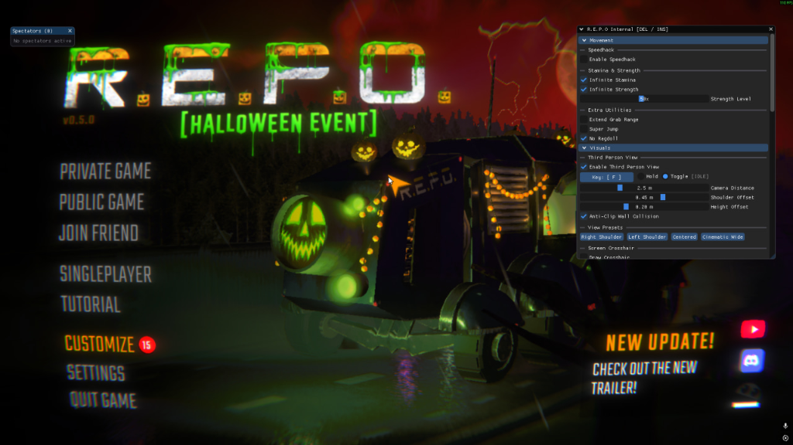

# R.E.P.O Internal

An internal cheat for **R.E.P.O** (DirectX 11, x64).

## Hotkeys

| Key | Action |
| :--- | :--- |
| `Delete` / `Insert` | Toggle Menu |
| `F` | Third Person |
| `V` | Speedhack |
